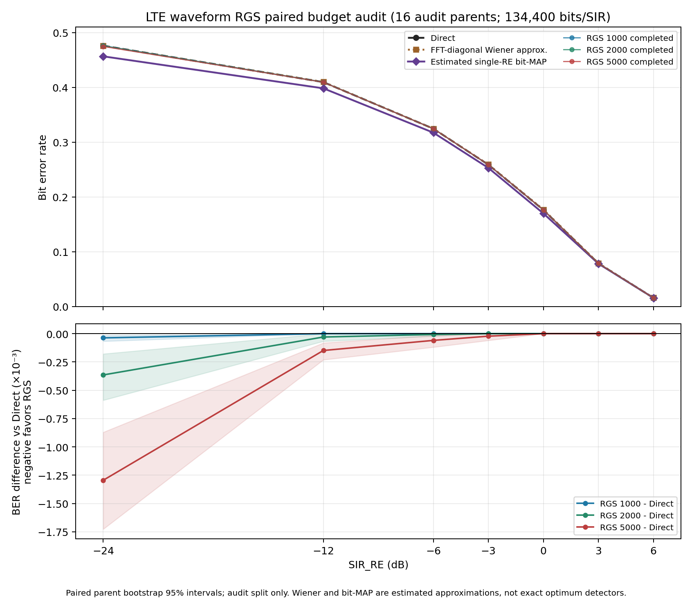

# LTE waveform α-RGS: paired 1k/2k/5k budget audit

**Outcome:** the frozen model and current receiver do **not** meet the stated
goal of a credible BER advantage over the traditional comparators. The 5,000-step
run produces a small BER improvement over Direct only at the low-SIR points;
none of the three completed budgets is convincingly better than the estimated
single-RE bit-MAP baseline. In the 0, +3, and +6 dB audit aggregates, every
RGS budget has exactly the same number of bit errors as Direct. Therefore this
audit does not justify choosing a shorter formal budget on the premise that it
will show model superiority. The formal test remains paused.

## Frozen protocol and coverage

- Audit split only: 16 parent IDs `1000000..1000015` at SIR_RE
  `[-24,-12,-6,-3,0,3,6]`, yielding 112 complete `(SIR,parent)` shards.
  Each method has 8,400 target bits per parent, hence 134,400 per SIR.
- Same observation, Direct hard-QPSK remodulation initialization, and per-slot
  random seeds for completed 1,000-, 2,000-, and 5,000-step runs. Each completed
  budget has its *own* cosine schedule from max LR `1e-4` to min LR `1e-6`.
  The 5,000-step run also stores 1,000/2,000-step **same-path snapshots**;
  those are separately labelled and not treated as completed short budgets.
- Final frozen EMA target/interference priors are the 200k/300k checkpoints.
  Resolved platform, calibration, train-only baseline statistics, and weight
  SHA-256 identities are in the ignored atomic run manifest
  `artifacts/rgs_ber_5000/audit_paired_budgets_20260923/resolved_config.json`.
- Three paired comparators are Direct, train-statistics-based FFT-diagonal
  approximate Wiener (not exact LMMSE), and estimated single-RE marginal
  bit-MAP (not global waveform MAP). No clean/oracle detector is included as a
  practical comparator. Truth is used after inference for scoring only.
- The strict summarizer accepted all 112 unique shards, exactly eight expected
  rows per shard, one κ per shard, 8,400-bit integer counts, full method/parent
  coverage, and 1,000/2,000/5,000 calls to **each** prior for the respective
  completed budgets. Paused partial formal-test RGS shards were not used for
  budget selection or this report.

## BER (integer counts are in the linked CSV)

| SIR_RE dB | Direct | Wiener approx. | Est. bit-MAP | RGS 1k | RGS 2k | RGS 5k |
|---:|---:|---:|---:|---:|---:|---:|
| -24 | 0.476012 | 0.475818 | **0.456592** | 0.475975 | 0.475647 | 0.474717 |
| -12 | 0.409561 | 0.409896 | **0.398229** | 0.409561 | 0.409531 | 0.409412 |
| -6 | 0.324606 | 0.324613 | **0.317344** | 0.324606 | 0.324598 | 0.324546 |
| -3 | 0.258839 | 0.259249 | **0.252991** | 0.258839 | 0.258839 | 0.258817 |
| 0 | 0.176332 | 0.177039 | **0.169978** | 0.176332 | 0.176332 | 0.176332 |
| +3 | 0.078772 | 0.079211 | **0.078281** | 0.078772 | 0.078772 | 0.078772 |
| +6 | 0.015848 | 0.016027 | 0.015878 | 0.015848 | 0.015848 | 0.015848 |

At -24 dB, RGS 5k saves 174 errors versus Direct (63,802 vs 63,976), an
absolute BER difference of -0.001295, with parent-paired bootstrap 95% interval
[-0.001726, -0.000871]. At -12 and -6 dB it saves 20 and 8 errors respectively.
The 5k-minus-Direct differences at 0, +3, and +6 dB are exactly zero across
all 16 parents' error counts. These bootstrap intervals use 10,000 resamples
of the 16 parents and are exploratory, not multiplicity-adjusted.

The estimated bit-MAP point estimate beats RGS 5k by 2,436 errors at -24 dB
and by 1,503 at -12 dB. At +6 dB, RGS is ahead by only four errors; its
parent-paired interval versus bit-MAP crosses zero. Thus there is no supported
claim that RGS is superior to the stronger comparator at any audit SIR.

The waveform NMSE and BER tell different stories: at +6 dB, mean target NMSE
falls from 1.007 (Direct mixture) to 0.0558 (RGS 5k), while both have
2,130/134,400 bit errors. This shows improved waveform reconstruction without
a corresponding improvement in these hard-QPSK decisions. It does not by
itself identify the cause; receiver/decision-margin diagnostics would be a
separate investigation before further formal testing.

## Compute and decision boundary

Observed per `(SIR,parent)` two-slot RGS time was approximately 11.5 s for
1k, 23.1 s for 2k, and 57.7 s for 5k on an RTX 4090; the combined shard
took about 92 s. Two GPUs completed all 112 shards in about 86 minutes.
This audit answers the comparison question for the **current** frozen model,
initialization, LR, and receiver. It does not establish an algorithmic limit,
and it does not license altering a partially run sealed test. Any new formal
budget/range should be explicitly chosen after reviewing this unfavorable
audit result, then run and labelled as a new experiment.

Reproducible aggregate artifacts: [complete count-level summary](rgs_budget_audit_20260923/summary.csv),
[parent-paired differences and intervals](rgs_budget_audit_20260923/paired_differences.csv),
[coverage record](rgs_budget_audit_20260923/progress.json), and
[PDF figure](rgs_budget_audit_20260923/ber_budget_audit.pdf).
